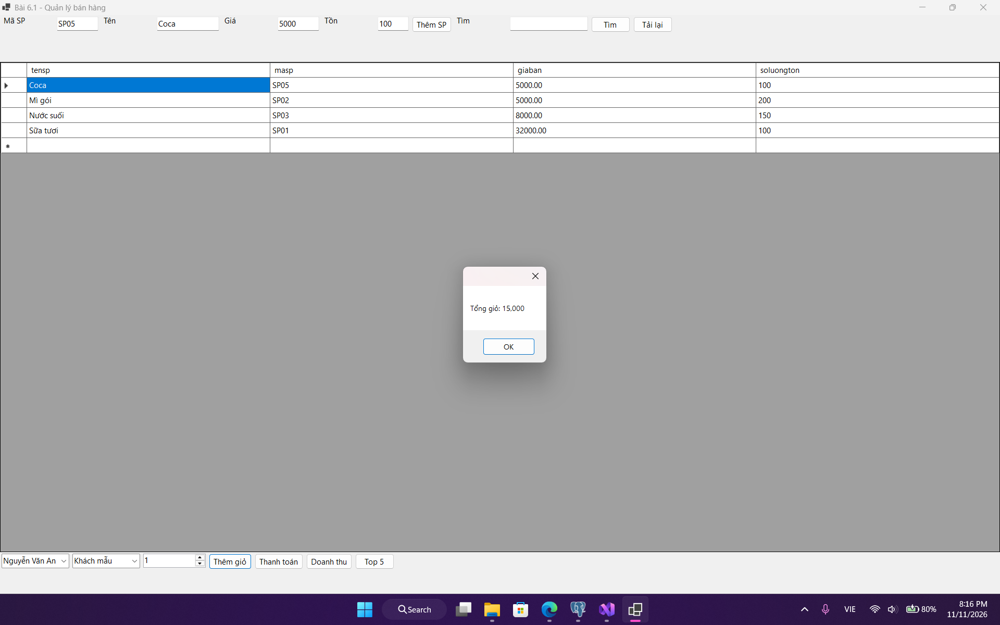
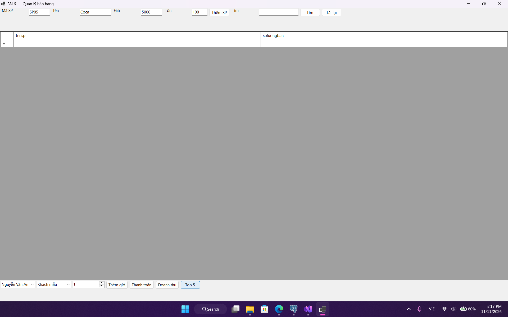
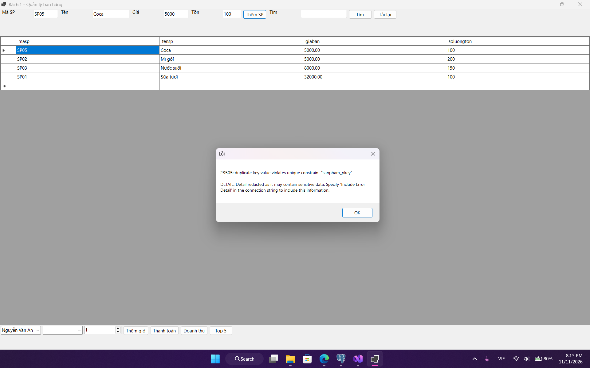

# Lập trình .NET

**Họ và tên:** Đỗ Xuân Nhất  

**Lớp:** D19CNPM5  

**Mã sinh viên:** 24810310475

## 1. Màn hình Chính / Tổng quan hệ thống:

## 2. Màn hình Quản lý Danh mục (CRUD - Thêm/Sửa/Xóa):

## 3. Màn hình Thực thi Nghiệp vụ chính (Lập Hóa đơn / Bán hàng / Chấm công / Đặt phòng):

## 4. Màn hình Báo cáo - Thống kê:

## 5. Minh họa An toàn Dữ liệu (Phòng chống SQL Injection / Báo lỗi Transaction Rollback):

